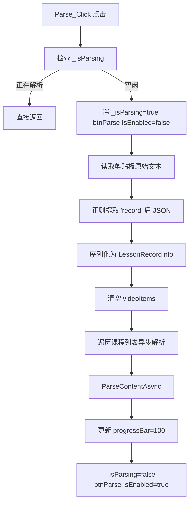
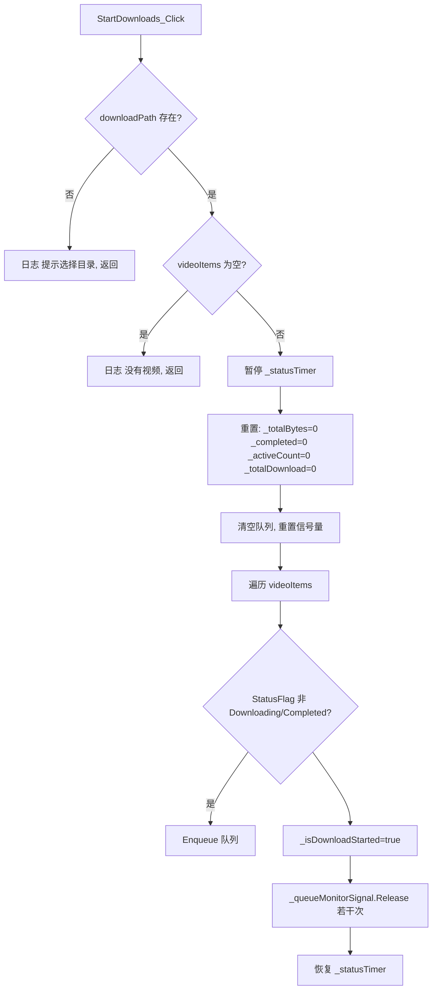
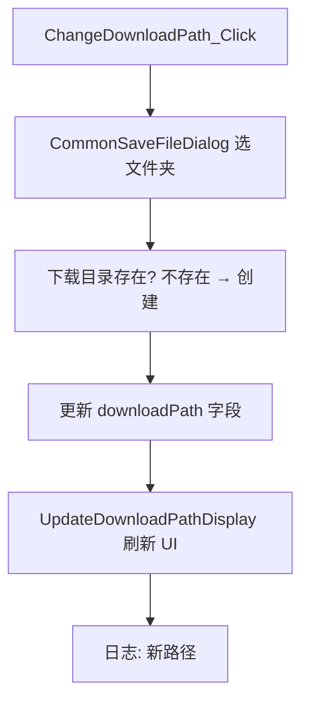
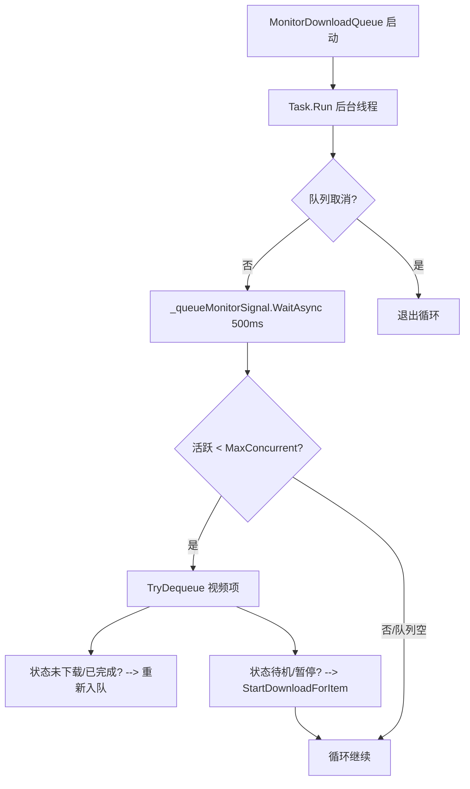

# Classin视频解析下载工具 - 功能规格说明书 (v1.0.0)

> **Project**: Classin视频解析下载工具 (图形化 v1.0.0)
> **Source analyzed**: `MainWindow.xaml.cs` (2740 lines), `MainWindow.xaml`, `App.xaml`/`App.xaml.cs`, `Program.cs`, `ViewLocator.cs`, `CHANGELOG.md`
> **Target framework**: .NET with WPF (Windows Presentation Foundation)
> **Document purpose**: Functional analysis / reverse-engineered specification for downstream re-implementation (FlowLens)

---

## 1. 项目概述 (Project Overview)

### 1.1 产品定位
Classin视频解析下载工具是一款针对ClassIn(班级吧)在线教育平台的视频内容解析与下载图形化工具。用户通过剪贴板获取ClassIn课程录制的`getLessonRecordInfo` JSON 数据, 工具自动解析视频下载链接及名称元数据, 并提供多线程、断点续传、并发控制的下载能力。最终将视频文件保存到用户指定的本地目录。

### 1.2 核心功能模块
| # | 模块 | 核心职责 |
|---|------|-----------|
| 1 | **视频解析 (Parse)** | 从剪贴板读取JSON, 提取课程名+下载链接, 校验URL有效性 |
| 2 | **视频下载 (Download)** | 多线程分块下载, 断点续传, 并发控制, 进度/速度/剩余时间统计 |
| 3 | **UI 交互** | 按钮事件驱动, 状态实时更新, 错误/日志反馈, DPI自适应 |
| 4 | **辅助服务** | 剪贴板操作, 日志文件写入, 窗口状态管理, 文件命名清洗 |

### 1.3 技术栈
- **UI**: WPF (XAML + C# 代码隐藏)
- **网络**: `HttpClient`, `HttpWebRequest` (HTTP Range 分块下载)
- **并发**: `SemaphoreSlim`, `ConcurrentQueue`, `ConcurrentBag`, `Task`, `CancellationTokenSource`
- **原生调用**: `DllImport` — `kernel32.dll`, `user32.dll` (控制台窗口隐藏, 剪贴板, 菜单移除)

> **NOTE**: `Program.cs`/`ViewLocator.cs` 导入 `Avalonia` 命名空间, 但 `MainWindow.xaml` 采用 **WPF XAML 命名空间** (`http://schemas.microsoft.com/winfx/2006/xaml/presentation`)。本说明书以 **WPF 投影** 为准, 修正了 `Program.cs` 中引用的命名空间歧义(实际应为 WPF 的 `Application` 而非 Avalonia `App`)。

---


---

## 2. 功能模块列表 (Module Catalog)

### 2.1 核心类结构
```
VideoDownloader (namespace)
├── IndexFormatConverter       : IValueConverter  — 整数索引转固占 2 位数字符串
├── HeightConverter            : IValueConverter  — 计算列表项高度 (30~80)
├── DarkenColorConverter       : IValueConverter  — 鼠标悬浮/按下染色
├── ScalingConverter           : IValueConverter  — DPI 等比缩放字体/控件
├── PathMaxWidthConverter      : IValueConverter  — 下载路径文本最大宽度
├── NativeMethods              : Win32 API 静态导入集合
├── VideoItem : INotifyPropertyChanged
│   ├── 属性：DisplayIndex, Name, Url, FileSize, Status, Progress, DownloadedBytes, TotalBytes,
│   ├──        CurrentSpeedBytesPerSec, RemainingTime, Phase, LastReportedBytes, StatusColor,
│   │         DownloadTokenSource, StatusFlag(枚举), DisplayStatus(只读)
│   └── 静态方法：FormatSize, FormatSpeed, FormatTime
├── DownloadManager            : 静态下载引擎
│   ├── 属性 (MaxDownloadThreads/set), 静态方法:
│   │   DownloadFileAsync, GetFileSizeAsync, CancelDownload, SetSpeedLimit,
│   │   GetMaxConcurrentDownloads, SetMaxConcurrentDownloads
│   └── 内部私有：CreateChunkAsync, CalculateChunkSize
└── MainWindow : Window (主窗口 + 所有 UI 逻辑)
```

### 2.2 MainWindow 字段与常量
| 字段 / 常量 | 类型 | 说明 |
|-------------|------|------|
| `DEFAULT_MAX_CONCURRENT_DOWNLOADS` | `const int = 3` | 默认最大并发任务数 |
| `DEFAULT_MAX_DOWNLOAD_THREADS` | `const int = 4` | 默认单文件分块线程数 |
| `UI_UPDATE_THROTTLE_MS` | `const int = 100` | UI 刷新节流 |
| `videoItems` | `ObservableCollection<VideoItem>` | 绑定到 `lstResults` 的解析结果集 |
| `downloadPath` | `string` | 当前下载目录 |
| `_maxConcurrentDownloads` | `int` | 运行时最大并发数 (默认 3) |
| `_downloadSemaphore` | `SemaphoreSlim` | 并发槽位信号量 |
| `_globalCts` | `CancellationTokenSource` | 全局取消令牌 |
| `_activeDownloadTasks` | `ConcurrentBag<Task>` | 活跃下载任务集合 |
| `_activeDownloadCount` | `int` | 当前活动下载计数器 (Interlocked) |
| `_downloadQueue` | `ConcurrentQueue<VideoItem>` | 等待下载队列 |
| `_queueMonitorSignal` | `SemaphoreSlim` | 唤醒队列监控线程 |
| `_queueCts` | `CancellationTokenSource` | 队列监控取消令牌 |
| `_totalBytesToDownload` | `long` | 总下载字节累计 |
| `_totalDownloadedBytes` | `long` | 累计已下载字节 (Interlocked.Add) |
| `_completedDownloads` | `int` | 完成数计数器 |
| `_statusTimer` | `DispatcherTimer` | 0.5s 状态刷新定时器 |
| `currentDpiScale` | `double` | 当前 DPI 缩放因子 |

### 2.3 XAML 控件清单 (MainWindow.xaml)
| 控件 (x:Name) | 类型 | 绑定 / 用途 |
|---------------|------|-------------|
| `txtUrl` | TextBox | 视频链接输入框 (备用手动输入) |
| `btnParse` | Button | 点击 → `Parse_Click` |
| `btnCopyCommand` | Button | 点击 → `CopyCommand_Click`(复制剪贴板筛选文本) |
| `btnChangePath` | Button | 点击 → `ChangeDownloadPath_Click` |
| `btnStartDownload` | Button | 点击 → `StartDownloads_Click` |
| `btnCancelDownload` | Button | 点击 → `CancelDownload_Click` |
| `btnOpenFolder` | Button | 点击 → `OpenFolder_Click` |
| `btnClearResults` | Button | 点击 → `ClearResults_Click` |
| `btnHelp` | Button | 点击 → `Help_Click` |
| `progressBar` | ProgressBar | 解析 / 下载全局进度 (0~100) |

---

## 3. 视频解析功能 (Video Parse)

### 3.1 Parse_Click — 解析按钮点击


**输入**: 无 (读取剪贴板)
**输出**: 填充 `videoItems` ObservableCollection
**状态变化**:
- `_isParsing: false → true`
- `btnParse.IsEnabled: true → false`
- `progressBar.Value: 0 → 10→100` (阶段性)
- `videoItems` 清空后重填

**错误处理**:
- 剪贴板为空/非法 → `AppendLog("剪贴板内容无效...")`
- JSON 反序列化失败 → `AppendLog($"解析失败: {ex.Message}")`
- 单个课程解析异常 → 捕获继续下一个, 记录日志

### 3.2 ParseContentAsync — 异步解析内容
```mermaid
flowchart TD
    A[ParseContentAsync course] --> B[HttpClient GET 课程分享链接]
    B --> C[获取重定向后真实视频页 HTML]
    C --> D[正则提取 m3u8 地址 / mp4 URL]
    D --> E[GetFileSizeAsync HEAD 请求]
    E --> F[fileSize<=0? --> 设为0 显示未知]
    F --> G[创建 VideoItem: 名称=CleanName(课程名)+后缀]
    G --> H[加入 videoItems + 更新 DisplayIndex]
    H --> I[lstResults.Items.Refresh]
```

**输入**:
- `CourseInfo` 对象 (含 `courseName`, `shareUrl`)
- 参数: `string fileName`, `string videoUrl`, `bool useOriginalName`

**关键子方法**:
```csharp
// 从剪贴板 JSON 解析出课程列表
private List<CourseInfo> ParseCourseInfo(string clipboardText);

---

## 4. 视频下载功能 (Video Download)

### 4.1 DownloadManager (静态下载引擎)

#### 4.1.1 DownloadFileAsync
**签名**:
```csharp
public static async Task<bool> DownloadFileAsync(
    string url, string filePath, Action<long,double,TimeSpan> progress,
    int maxThreads = 4, CancellationToken ct = default)
```
**流程**:
```mermaid
flowchart TD
    A[DownloadFileAsync] --> B{文件已存在?}
    B -- 否 --> C[创建空文件]
    B -- 是 --> D[获取本地大小 startBytes]
    D --> E[GetFileSizeAsync HEAD]
    E --> F{startBytes==fileSize?}
    F -- 是/一致 --> Z[返回true 已完成]
    F -- 否/不一致 --> G[计算总大小 totalBytes]
    G --> H[分割分片: chunkSize = total/(maxThreads)]
    H --> I[创建多 Task 并行]
    I --> J[每个 Task: CreateChunkAsync HTTP Range]
    J --> K[写入 FileStream 指定 Position]
    K --> L[ProgressCallback 报告]
    L --> M{ct 取消?}
    M -- 否 --> N[全部完成?]
    N -- 是 --> O[返回 true]
    M -- 是 --> P[返回 false]
    N -- 否 --> M
```

**HTTP Range 分片写入逻辑** (CreateChunkAsync):
```csharp
private static async Task DownloadChunkAsync(
    HttpWebRequest request, long start, long end, string filePath,
    long startBytes, CancellationToken ct, Action<long,double> progress)
{
    request.AddRange(start, end);        // Range: bytes start-end
    using var response = await request.GetResponseAsync();
    using var stream = response.GetResponseStream();
    using var fs = new FileStream(filePath, FileMode.OpenOrCreate, FileAccess.Write, FileShare.ReadWrite);
    fs.Seek(start, SeekOrigin.Begin);    // 定位到分片起始
    // 读取缓冲 读写循环
    byte[] buffer = new byte[BUFFER_SIZE];
    long totalRead = startBytes > start ? startBytes - start : 0;
    while (true) {
        int read = await stream.ReadAsync(buffer, 0, buffer.Length, ct);
        if (read == 0) break;
        await fs.WriteAsync(buffer, 0, read, ct);
        Interlocked.Add(ref downloaded, read);
        progress?.Invoke(downloaded, speed);
    }
}
```


---

## 5. UI 交互逻辑 (UI Interaction)

### 5.1 主按钮点击事件

| 按钮 | Click 事件 | 主要逻辑 |
|------|-----------|----------|
| btnParse | `Parse_Click` | 读取剪贴板 → 解析 JSON → 填充 videoItems |
| btnCopyCommand | `CopyCommand_Click` | 复制过滤文本到剪贴板 (STA 线程重试 5 次) |
| btnStartDownload | `StartDownloads_Click` | 校验下载路径/项目非空 → 重置状态 → 入队所有待下载项 |
| btnCancelDownload | `CancelDownload_Click` | `_globalCts.Cancel()` → 取消所有下载 |
| btnOpenFolder | `OpenFolder_Click` | `Process.Start("explorer.exe", downloadPath)` |
| btnClearResults | `ClearResults_Click` | 清空 videoItems + 重置统计 |
| btnChangePath | `ChangeDownloadPath_Click` | 打开 `CommonSaveFileDialog` 选目录 |
| btnHelp | `Help_Click` | 显示帮助文本窗口 |

### 5.2 StartDownloads_Click — 开始下载


### 5.3 CancelDownload_Click — 取消下载
- 调用 `_globalCts.Cancel()`
- 日志 `"正在取消所有下载..."`
- 每个 `VideoItem.DownloadTokenSource` 关联该全局CTS
- `DownloadSingleVideoAsync` 捕获 `OperationCanceledException`

### 5.4 ClearResults_Click
- 清空 `videoItems`
- 重置 `progressBar.Value = 0`
- 清零统计变量
- 显示 `"已清空解析结果"` 日志

### 5.5 DPI 缩放 (DPI Scaling)
```csharp
protected override void OnDpiChanged(DpiScale oldDpi, DpiScale newDpi) {
    base.OnDpiChanged(oldDpi, newDpi);
    currentDpiScale = newDpi.DpiScaleX;
    ApplyDpiScaling();
}
private void ApplyDpiScaling() {
    MinWidth = 800 * currentDpiScale;
    MinHeight = 450 * currentDpiScale;
    UpdateLayout();
    InvalidateVisual();

---

## 6. 辅助功能 (Auxiliary)

### 6.1 剪贴板操作
- `CopyCommand_Click`:
  1. 创建独立 `CancellationTokenSource`
  2. 禁用按钮, progressBar=10%
  3. 调用 `SafeSetClipboard(text, token)` — 启动 STA 线程, 5 次重试 `OpenClipboard/EmptyClipboard/SetClipboardData`
  4. 操作完成后 progressBar=100%, 日志反馈
- `NativeMethods` 引用:
```csharp
[DllImport("user32.dll")] static extern bool OpenClipboard(IntPtr hWnd);
[DllImport("user32.dll")] static extern bool EmptyClipboard();
[DllImport("user32.dll")] static extern IntPtr SetClipboardData(uint uFormat, IntPtr hMem);
[DllImport("user32.dll")] static extern bool CloseClipboard();
```

### 6.2 原生窗口控制 (Native Window API)
| API | 用途 |
|-----|------|
| `GetConsoleWindow` + `ShowWindow(hWnd, SW_HIDE)` | 隐藏控制台窗口 (发布为 Windowless 时) |
| `GetSystemMenu` + `DeleteMenu` | 移除窗口右上最小化/最大化/关闭按钮 (自定义关闭逻辑) |

### 6.3 下载路径变更 (ChangeDownloadPath_Click)


### 6.4 格式化工具 (静态方法, VideoItem)
| 方法 | 输入 | 输出 |
|------|------|------|
| `FormatSize(long bytes)` | 字节 | `"X.XX GB/MB/KB/B"` |
| `FormatSpeed(double bytesPerSec)` | B/s | `"X.XX GB/s/MB/s/KB/s/B/s"` |
| `FormatTime(TimeSpan time)` | 时间 | `"HH:mm:ss"` 或 `"未知"` |
| `FormatTotalSpeed(double bytesPerSecond)` | B/s | `"X.XX Gb/s/Mb/s/Kb/s/B/s"` |

### 6.5 文件完整性校验
```csharp
// 下载完成后校验
var fileInfo = new FileInfo(outputFile);
if (item.FileSize > 0 && fileInfo.Length != item.FileSize)
    throw new Exception($"文件验证失败: 实际大小 {fileInfo.Length}, 预期大小 {item.FileSize}");
```

---

## 7. 状态机 (State Machine)

### 7.1 VideoItem.DownloadStatus 枚举
```csharp
public enum DownloadStatus {
    Pending,    // 等待 (初始/已取消)
    Parsing,    // 解析中
    Parsed,     // 已解析
    Partial,    // 已暂停/断点
    Downloading,// 下载中
    Completed,  // 完成
    Failed,     // 失败/超时
}
```

### 7.2 VideoItem 状态流转
```mermaid

---

## 8. 错误处理汇总 (Error Handling)

| 场景 | 处理方式 |
|------|----------|
| 剪贴板内容无效 | `AppendLog` 报错, 保持 UI 可用 |
| JSON 反序列化失败 | 捕获, 日志, 不中断其他课程 |
| 单个课程解析失败 | 继续下一个, 日志记录 |
| 下载超时 (30s) | `Status="下载超时"`, 标记 `Failed` |
| 下载取消 | 存在文件 → `Partial`, 无文件 → `Pending(已取消)` |
| 下载失败 (网络) | 重试 (最长 3 次), 指数退避 |
| 文件校验不一致 | 抛异常, 标记 `Failed` |
| 下载目录不存在 | `OpenFolder_Click` 提示, `StartDownloads` 要求先选目录 |

---

## 9. 功能流程总图 (Overall Flow)

```mermaid
flowchart TD
    Start([启动应用程序]) --> Init[MainWindow 初始化<br/>加载默认路径/定时器/队列监控线程]
    Init --> Idle[等待用户操作<br/>btnParse 启用]
    Idle --> Paste[点击 解析<br/>读取剪贴板]
    Paste --> Parse[ParseContentAsync<br/>遍历课程提取链接 + 大小]
    Parse --> Show[视频列表显示在 lstResults]
    Show --> Choose[用户选择保存路径/参数]
    Choose --> Dl[点击 开始下载<br/>入队所有视频]
    Dl --> Queue[MonitorDownloadQueue<br/>按并发数启动 DownloadSingleVideoAsync]
    Queue --> Prog[ProgressCallback 更新进度/速度/剩余]
    Prog --> Finish{全部完成？}
    Finish -->|否 | Queue
    Finish -->|是 | Done[日志 视频下载已完成<br/>progressBar=100]
    Done --> Opt[可 打开文件夹/清空/取消]

---

## 10. 边界情况 & 隐含逻辑 (Edge Cases)

1. **空剪贴板**: 提示 "剪贴板内容无效"
2. **多视频并发**: `SemaphoreSlim` 限制 `_maxConcurrentDownloads`, 超过排队
3. **断点续传**: 本地有部分文件时通过 `Range` 继续下载
4. **文件大小未知**: `ContentLength == -1` 时 `FileSize=0`, 显示未知
5. **UI 节流**: `ProgressCallback` 100ms 节流防止 UI 阻塞
6. **DPI 自适应**: 字体等比缩放，最小窗口尺寸随 DPI 放大
7. **窗口最小化隐藏**: `ShowWindow(GetConsoleWindow(), SW_HIDE)`
8. **日志滚动**: `txtLog` 自动滚动到底 (`_logScrollToEnd`)
9. **重试机制**: 下载失败指数退避重试，超时 30s
10. **取消传播**: `_globalCts.Cancel()` 级联取消所有下载任务
11. **完成校验**: 下载完成验证文件大小一致性
12. **路径非法字符**: `CleanName` 过滤 `\/:*?"<>|`, 空格转换
13. **队列空闲检测**: `_downloadQueue.IsEmpty && _activeDownloadCount == 0` → 下载完成
14. **激活下载监测**: `CheckAllDownloadsCompleted` 检查是否全部完成
15. **状态栏实时汇总**: 定时器 500ms 聚合速度/进度/活跃数

---

## 11. 需求映射 (Traceability)

| 需求 ID | 描述 | 实现位置 |
|---------|------|----------|
| REQ-PARSE-01 | 剪贴板读取解析 | `Parse_Click`, `ParseCourseInfo` |
| REQ-PARSE-02 | 批量课程异步解析 | `ParseContentAsync` |
| REQ-DL-01 | HTTP Range 分块下载 | `DownloadFileAsync`, `CreateChunkAsync` |
| REQ-DL-02 | 断点续传 | 读取 `localSize`, 传入 `startBytes` |
| REQ-DL-03 | 并发控制 | `_downloadSemaphore`, `MonitorDownloadQueue` |
| REQ-DL-04 | 下载进度/速度/剩余 | `ProgressCallback`, `StatusTimer_Tick` |
| REQ-DL-05 | 取消/暂停 | `_globalCts`, `VideoItem.DownloadTokenSource` |
| REQ-UI-01 | DPI 自适应 | `OnDpiChanged`, `ApplyDpiScaling` |
| REQ-UI-02 | 日志输出 | `AppendLog` |
| REQ-AUX-01 | 剪贴板复制 | `CopyCommand_Click`, `SafeSetClipboard` |
| REQ-AUX-02 | 文件命名清洗 | `CleanName` |
| REQ-AUX-03 | 文件校验 | `DownloadSingleVideoAsync` 尾部校验 |

---

*文档生成日期*: 2026-10-25
*分析工具*: deepseek-v4-pro (静态代码分析)
*文档版本*: v1.0.0-spec

```

| 剪贴板操作异常 | 5 次重试后记录日志 |
| 窗口关闭时任务 | `_globalCts.Cancel()` + 信号量释放 |

stateDiagram-v2
    [*] --> Pending: 初始
    Pending --> Parsing: ParseContentAsync 开始
    Parsing --> Parsed: 成功
    Parsing --> Failed: 异常
    Parsed --> Downloading: 开始下载
    Downloading --> Completed: 成功
    Downloading --> Partial: 暂停
    Downloading --> Failed: 超时/失败
    Partial --> Downloading: 继续
    Failed --> Downloading: 重试
    Completed --> [*]
    Failed --> [*]
```


    UpdateLayoutBindings();
}
```
- 注册 `Source` CompositionTarget 变化监听
- 利用 `ScalingConverter` (BaseWidth=1440) 实现等比字体缩放

### 5.6 窗口状态管理
| 事件 | 处理 |
|------|------|
| `Window_Loaded` | 初始化下载路径 (默认 `BaseDirectory\Download`), 显示路径, 初始化控件 |
| `Window_Closing` | `_globalCts.Cancel()`, `_queueCts.Cancel()`, `Dispose` 信号量, 日志记录 |
| `Window_SizeChanged` | 记录原始列宽比, 触发布局重绘 |

### 5.7 日志输出 (AppendLog)
- 附加日志到 `txtLog` (滚动到底 `ScrollToEnd`)
- 同时写入本地 `log.txt` (追加模式)
- 时间戳格式: `[yyyy-MM-dd HH:mm:ss]`

#### 4.1.2 GetFileSizeAsync
```csharp
private static async Task<long> GetFileSizeAsync(string url)
{
    var request = (HttpWebRequest)WebRequest.Create(url);
    request.Method = "HEAD";     // 仅获取头部
    using var resp = await request.GetResponseAsync();
    return resp.ContentLength;   // -1 时视为未知
}
```

#### 4.1.3 其他管理方法
| 方法 | 说明 |
|------|------|
| `SetSpeedLimit(double bytesPerSec)` | 设置速度阈值, 下载前后 `Thread.Sleep` 补偿 |
| `SetMaxConcurrentDownloads(int n)` | 更新 `_maxConcurrentDownloads`, 释放信号量 |
| `GetMaxConcurrentDownloads()` | 返回当前并发数 |
| `CancelDownload(CancellationToken ct)` | 取消当前下载 (由 `VideoItem.DownloadTokenSource` 调用) |

### 4.2 DownloadSingleVideoAsync — 单个视频下载
```mermaid
flowchart TD
    A[DownloadSingleVideoAsync item, ct] --> B[初始化 timeoutCts 30s]
    B --> C[linkedToken 组合全局+项+超时]
    C --> D[获取已下载大小 localSize]
    D --> E[GetFileSizeAsync 远程大小]
    E --> F{本地==远程?}
    F -- 是 --> G[标记 Completed, 完成数++]
    F -- 否 --> H{本地>0 & <远程?}
    H -- 是 --> I[标记 Partial, 继续下载]
    H -- 否 --> J[从头下载]
    I --> K[ProgressCallback 定义 UI更新逻辑]
    J --> K
    K --> L[DownloadManager.DownloadFileAsync]
    L --> M{成功?}
    M -- 是 --> N[验证文件大小 == FileSize
        N -- 一致 --> O[标记 Completed]
        N -- 不一致 --> P[异常 文件验证失败]
    M -- 否 --> Q{文件存在?}
    Q -- 是 --> R[标记 Partial/暂停]
    Q -- 否 --> S[标记 下载失败]
    P --> T[retryCount++; 超过上限? → 标记 Failed]
    R --> T
    S --> T
    T -- 未超限 --> U[退避重试 2^retry*1000ms]
    U --> L
```

**关键常量**:
- `maxRetries = 3` 默认重试次数
- 超时: `CancellationTokenSource` 30 秒 (Timeout 取消分类处理)

**错误类型处理**:
| 异常 | 分类 | 结果 |
|------|------|------|
| `OperationCanceledException` & `timeoutCts` | 超时 | `Status="下载超时"`, `StatusColor=Red`, `StatusFlag=Failed` |
| `OperationCanceledException` 一般 | 取消 | 存在文件→`"已暂停"` Partial; 不存在→`"已取消"` Pending |
| 其他 `Exception` | 下载失败 | 重试(上限) → `Status="下载失败"`, Red, Failed |

### 4.3 ProgressBar / ProgressCallback 更新逻辑
```csharp
void ProgressCallback(long downloaded, long total, double speed, TimeSpan remaining)
{
    var now = DateTime.Now;
    if ((now - _lastUiUpdate).TotalMilliseconds < 100) return; // 节流
    _lastUiUpdate = now;
    Dispatcher.BeginInvoke(new Action(() => {
        long delta = downloaded - item.LastReportedBytes;
        item.LastReportedBytes = downloaded;
        Interlocked.Add(ref _totalDownloadedBytes, delta);
        item.DownloadedBytes = downloaded;
        item.TotalBytes = total;
        item.Progress = total > 0 ? (int)(downloaded*100/total) : item.Progress;
        item.CurrentSpeedBytesPerSec = speed;
        item.RemainingTime = remaining;
    }), DispatcherPriority.Background);
}
```

### 4.4 状态汇总更新 (StatusTimer_Tick / UpdateStatusSummary)
- 触发: `DispatcherTimer` 每 500ms
- 聚合统计: `totalSpeed`, `anyDownloading`
- 百分比: `100 * _totalDownloadedBytes / _totalBytesToDownload`
- 输出文字至 `txtStatusSummary`:
```
当前下载速度: X Mb/s | 已下载: Y/N | 下载完成: Z% | 活动下载数: A/B
```


// 清洗文件名 — 移除非法字符
private string CleanName(string input, bool replaceSpaces = true);

// 获取文件大小 (HEAD, 支持 Range)
private async Task<long> GetFileSizeAsync(string url);

// 更新视频项序号
private void UpdateVideoIndexes();
```

**CleanName 规则**:
- 移除 `\/:*?"<>|`
- 连续空格 → 单空格
- 超长截断 (默认 200 字符)
- `replaceSpaces` 时空格 → `_`

### 3.3 MonitorDownloadQueue — 队列监控 (后台)


| `txtDownloadPath` | TextBlock | 当前下载目录显示 |
| `txtLog` | TextBox (ReadOnly) | 日志滚动输出 |
| `lstResults` | ListView | 绑定 `videoItems`, ItemTemplate 含序号/名称/状态/进度条/大小/速度/剩余 |
| `cmbQuality`, `cmbMaxThreads`, `nudMaxConcurrency` | ComboBox / NumericUpDown | 下载参数配置 |
| `statusBarGrid` | Grid | 状态栏容器 |
