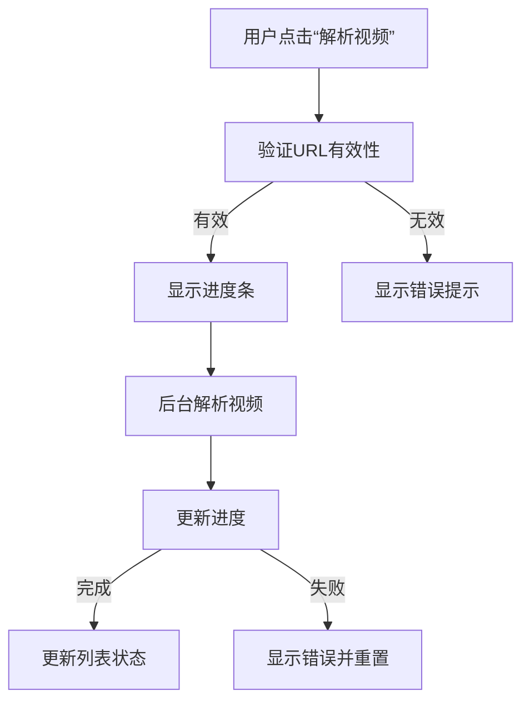

# UI 规格说明书 - Classin 视频解析下载工具
*版本：1.0.0*

---

## 1. 窗口布局概述
### 1.1 窗口大小与位置
- **默认大小**：1200px × 800px
- **最小大小**：800px × 600px
- **最大大小**：无限制（可拉伸）
- **窗口标题**：Classin 视频解析下载工具
- **窗口图标**：`Resources/icon.png`

---

## 2. XAML 布局结构
### 2.1 主窗口结构
```xml
<Window x:Class="Classin.MainWindow"
        xmlns="http://schemas.microsoft.com/winfx/2006/xaml/presentation"
        xmlns:x="http://schemas.microsoft.com/winfx/2006/xaml"
        Title="Classin 视频解析下载工具"
        Height="800" Width="1200"
        WindowStartupLocation="CenterScreen"
        ResizeMode="CanResizeWithGrip"
        WindowStyle="ToolWindow">
    <!-- XAML 布局代码见上文 -->
</Window>
```

---

## 3. 样式与主题
### 3.1 颜色主题
| 元素类型       | 颜色值（Hex）       | 说明                     |
|----------------|----------------------|---------------------------|
| 主题背景色     | `#2B2B2B`            | 深灰色背景               |
| 按钮背景色     | `#4A4A4A`            | 悬停：`#5A5A5A`          |
| 按钮文本色     | `#FFFFFF`            | 白色文本                 |
| 边框色         | `#555555`            | 灰色边框                 |
| 进度条颜色     | `#00A86B`            | 绿色进度条               |
| 状态栏背景     | `#3A3A3A`            | 深灰色状态栏             |

### 3.2 样式表（ResourceDictionary）
```xml
<ResourceDictionary xmlns="http://schemas.microsoft.com/winfx/2006/xaml/presentation">
    <!-- 按钮样式 -->
    <Style TargetType="Button">
        <Setter Property="Background" Value="#4A4A4A"/>
        <Setter Property="Foreground" Value="#FFFFFF"/>
        <Setter Property="BorderBrush" Value="#555555"/>
        <Setter Property="BorderThickness" Value="1"/>
        <Setter Property="CornerRadius" Value="3"/>
        <Setter Property="Padding" Value="5,2"/>
        <Setter Property="Margin" Value="2"/>
        <Style.Triggers>
            <Trigger Property="IsMouseOver" Value="True">
                <Setter Property="Background" Value="#5A5A5A"/>
            </Trigger>
        </Style.Triggers>
    </Style>
</ResourceDictionary>
```

---

## 4. 交互逻辑
### 4.1 按钮交互
| 按钮名称       | 交互逻辑                                                                 | 状态变化                     |
|----------------|--------------------------------------------------------------------------|-------------------------------|
| 解析视频       | 触发视频解析流程，显示进度条并更新状态栏                          | 禁用：解析中                 |
| 下载视频       | 触发视频下载流程，显示下载进度条                                   | 禁用：未选中视频或下载中     |

---

## 5. 响应式设计
### 5.1 窗口调整逻辑
- **最小宽度**：800px（隐藏右侧详情面板，仅显示列表）。
- **最小高度**：600px（隐藏状态栏，仅显示内容区域）。

---

## 6. 状态管理
### 6.1 视频状态
| 状态值       | 含义                     | 图标 |
|---------------|---------------------------|-------|
| `Pending`     | 未处理                   | ⏳     |
| `Parsing`     | 解析中                   | 🔄     |
| `Parsed`      | 解析完成                 | ✅     |

---

## 7. UI 流程图
### 7.1 视频解析流程


---

## 8. 附录
### 8.1 截图示例
以下是模拟的 UI 截图描述（实际项目中应替换为真实截图）：

*图 1：主窗口布局*

---

### 8.2 XAML 代码片段
```xml
<!-- 进度条动画 -->
<Storyboard x:Key="ProgressAnimation">
    <DoubleAnimation Storyboard.TargetProperty="Value"
                     To="100"
                     Duration="0:0:0.3"
                     FillBehavior="Stop"/>
</Storyboard>
```